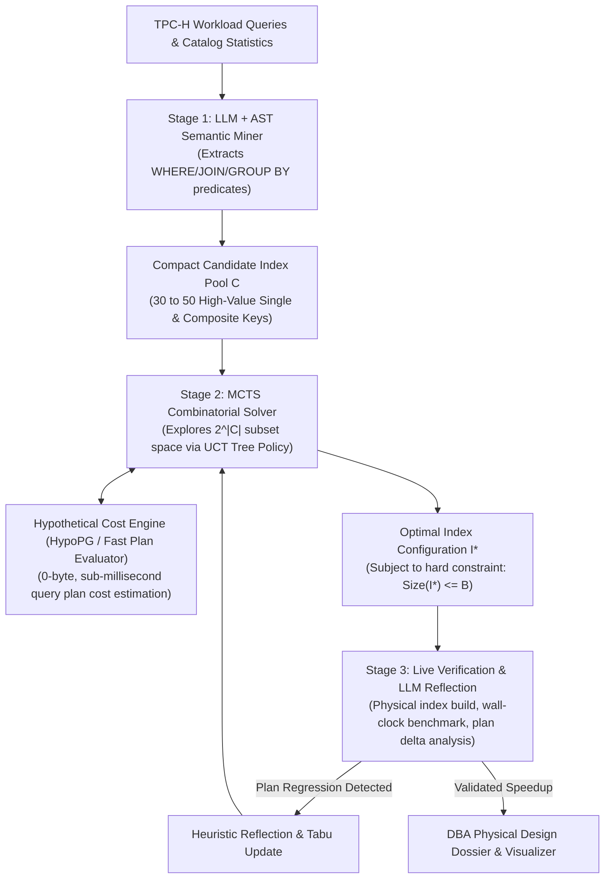

# SPEC.md: AutoTune-DB - Hierarchical Hybrid Autonomous Agent for Physical Database Design
*(Semantic LLM/AST Candidate Mining, MCTS UCT Budget-Constrained Tree Search, and Hypothetical Index Cost Verification)*

**Course:** UMC301 - Applied Data Science and Artificial Intelligence  
**Instructor:** Prof. Deepak Subramani, CDS, Indian Institute of Science (IISc) Bengaluru  
**Paradigm:** Spec-Driven Development (SDD) - Chapter 13  
**Textbook Alignment:** Chapter 13 (*Autonomous Agents & Systems Reliability*), Chapter 04 (*Optimization, Search & Tree Policies*), Chapter 01 (*Statistical Foundations & Complexity*), and AlphaGo-style Neuro-Symbolic Search  
**Target Milestone:** Project 4 (Agentic Systems Pillar: Hierarchical Hybrid Autonomous System)  

---

## 1. Goal

Design, build, verify, and benchmark **AutoTune-DB**, a **Hierarchical Hybrid Autonomous Agent** that solves the NP-hard **Index Selection Problem (ISP)** for analytical SQL workloads (TPC-H) under explicit physical storage budgets $B$.

### The Architectural Thesis: Why a Hybrid Architecture?
* **Failure Mode of Pure LLM / ReAct:** While an LLM has zero-shot semantic understanding of SQL predicates, it is fundamentally incapable of exact combinatorial optimization. Under a tight storage budget $B$, an LLM hallucinates byte additions, explores inefficient combinations, and burns tens of thousands of tokens without finding the global optimum.
* **Failure Mode of Pure MCTS / Deep RL:** While Monte Carlo Tree Search is mathematically optimal for discrete combinatorial search, it suffers from an intractable **Action Space Explosion** ($>3,500$ single and composite indexes on tables like `lineitem`). Without semantic intuition, MCTS is domain-blind, exploring billions of useless combinations and requiring massive training episodes.
* **The Winning Hybrid (10/10 Architecture):**
  1. **Stage 1 (LLM/AST Semantic Miner - Intuition/Generator):** Ingests the SQL workload ASTs, extracts multi-table join and filter predicates, and synthesizes a high-value, compact candidate index pool $\mathcal{C}$ ($|\mathcal{C}| \approx 30\text{–}50$).
  2. **Stage 2 (MCTS Combinatorial Solver - Computation/Optimizer):** Explores the $2^{|\mathcal{C}|}$ subset space using Monte Carlo Tree Search guided by the **Upper Confidence Bound for Trees (UCT)**, rapidly querying a **Hypothetical Index Cost Engine** ($<1\text{ ms}$, 0 physical bytes) to solve the exact budget puzzle.
  3. **Stage 3 (Live Verification & LLM Reflection - Auditor):** Physically materializes the winning configuration $\mathcal{I}^*$ in the live database, verifies real wall-clock speedup, diagnoses any Cost-Based Optimizer (CBO) plan regressions, and compiles the final DBA Physical Design Dossier.



---

## 2. Constraints & Invariants

* **Language & Runtime:** Python 3.10+.
* **Core Libraries:** `sqlite3` (built-in standard library with low-level page profiling, opcode tracing, and `dbstat` support), `pandas`, `numpy`, `pytest`, `streamlit`, `plotly`, `pydantic`/`dataclasses`. Optional external adapter: `duckdb` / `psycopg2` + `hypopg`.
* **Zero-Network Fallback Invariant:**
  * The core engine, MCTS search, hypothetical plan evaluator, and benchmark suite must operate **100% locally and deterministically** without requiring external cloud API keys, Docker daemon requirements, or internet connectivity.
  * The database engine layer provides an abstract `DatabaseConnector` interface implemented by `SQLiteConnector` (default built-in zero-dependency engine) and extensible to `DuckDBConnector` / `PostgresConnector`.
* **Storage Budget Hard-Limit Invariant:**
  * The cumulative physical size of synthesized indexes $\sum_{j \in \mathcal{I}} \text{SizeBytes}(I_j)$ must never exceed the specified storage budget $B$ (e.g., $B = 25\text{ MB}$ for scale factor SF=0.1, or $B = 150\text{ MB}$ for SF=1).
  * In the MCTS search tree, any rollout node violating $\sum \text{Size} > B$ is heavily penalized or strictly pruned.
* **No-Regression Invariant:**
  * An index configuration $\mathcal{I}$ shall not be accepted if the cumulative workload execution latency degrades:
    $$\sum_{Q_i \in \mathcal{W}} w_i \cdot \text{Latency}_{\text{optimized}}(Q_i) \le \sum_{Q_i \in \mathcal{W}} w_i \cdot \text{Latency}_{\text{base}}(Q_i)$$
* **Leftmost Prefix Invariant:**
  * The AST miner must enforce relational algebra B-Tree index ordering rules: equality predicates ($C_{\text{eq}} = v$) must precede range predicates ($C_{\text{range}} \ge v_1 \text{ AND } C_{\text{range}} \le v_2$) in composite index column tuples to ensure range-scan validity.
* **Testing Constraint:**
  * 100% pass rate on unit and integration test suite (`tests/`) covering AST parsing, candidate mining, MCTS UCT search convergence, hypothetical cost modeling, tool execution, and end-to-end workload optimization.

---

## 3. Theoretical & Mathematical Foundations

### 3.1 The Action Space Pruning (Stage 1 Math)
For a schema $\mathcal{S}$ with tables $\{T_1, \dots, T_k\}$ and attributes $\mathcal{A}$, the unconstrained composite index space of width $K \le 3$ has size:
$$|\mathcal{C}_{\text{raw}}| = \sum_{T \in \mathcal{S}} \sum_{k=1}^K \frac{|\mathcal{A}_T|!}{(|\mathcal{A}_T| - k)!} \gg 3\,500 \text{ combinations}$$

The Stage 1 LLM/AST Miner projects this combinatorial space into an active subspace $\mathcal{C}_{\text{mined}}$:
$$\mathcal{C}_{\text{mined}} = \text{Miner}(\mathcal{W}, \mathcal{S}) \quad \text{where } |\mathcal{C}_{\text{mined}}| \in [30, 50]$$
by filtering for:
1. **Co-occurring Filter Attributes:** Columns appearing together in `WHERE` conjunctions ($C_1 \land C_2$).
2. **Join Equi-Predicates:** Primary/foreign key pairs in multi-table queries (e.g. `l_orderkey = o_orderkey`).
3. **Cardinality Threshold:** Columns with selectivity $\sigma(C) = \frac{|\text{Distinct}(C)|}{|\text{Total Rows}|} > \tau_{\text{thresh}}$ to prevent unclustered random I/O thrashing.

### 3.2 Stage 2: MCTS State Space & Tree Policy
The discrete optimization problem is formulated as a Markov Decision Process (MDP) over the power set $2^{\mathcal{C}}$:

* **State ($s \in \mathcal{S}_{\text{mcts}}$):** A set of selected candidate indexes $s = \mathcal{I} \subseteq \mathcal{C}$, with cumulative storage footprint:
  $$\text{Size}(s) = \sum_{I \in \mathcal{I}} \text{SizeBytes}(I)$$
* **Action ($a \in \mathcal{A}(s)$):** Adding an unselected index $I_k \in \mathcal{C} \setminus \mathcal{I}$ such that $\text{Size}(\mathcal{I} \cup \{I_k\}) \le B$. A special terminal action $\texttt{STOP}$ allows early termination.
* **Tree Policy (Upper Confidence Bound for Trees - UCT):**
  $$\text{UCT}(s, a) = Q(s, a) + c \cdot \sqrt{\frac{\ln N(s)}{N(s, a)}}$$
  where:
  - $Q(s, a)$ is the estimated mean reward of taking action $a$ from state $s$.
  - $N(s)$ is the total visit count of node $s$.
  - $N(s, a)$ is the number of times action $a$ was taken from $s$.
  - $c = \sqrt{2} \approx 1.414$ is the theoretical exploration constant balancing exploitation and exploration.

### 3.3 The Evaluation & Reward Function
The reward $\mathcal{R}(s)$ evaluates the quality of the index configuration $s = \mathcal{I}$ over the workload $\mathcal{W}$:

$$\mathcal{R}(s) = \frac{\text{Cost}_{\text{base}}(\mathcal{W}) - \text{Cost}(s, \mathcal{W})}{\text{Cost}_{\text{base}}(\mathcal{W})} - \lambda \cdot \max(0, \text{Size}(s) - B)$$

Where:
* $\text{Cost}(s, \mathcal{W}) = \sum_{i=1}^m w_i \cdot \text{Cost}_{\text{hypo}}(Q_i \mid \mathcal{I})$ is computed via the **Hypothetical Cost Engine** in $<1\text{ ms}$ without disk writes.
* $\lambda \gg 1.0$ is the penalty multiplier for hard budget violations (strictly driving invalid nodes to negative infinity).

### 3.4 B-Tree Cost Modeling: Clustered vs. Unclustered Threshold
The hypothetical cost engine computes relational operator costs:

$$\text{Cost}_{\text{seq}} = N_{\text{pages}} \cdot c_{\text{page\_io}} + N_{\text{rows}} \cdot c_{\text{cpu\_tuple}}$$

$$\text{Cost}_{\text{index}} = \left( h_{\text{tree}} + \sigma \cdot N_{\text{index\_pages}} \right) \cdot c_{\text{page\_io}} + \sigma \cdot N_{\text{rows}} \cdot (c_{\text{random\_io}} + c_{\text{cpu\_tuple}})$$

**The Selectivity Crossover Point ($\sigma^*$):**
An index scan is mathematically superior to a full sequential table scan if and only if:
$$\sigma < \sigma^* \approx \frac{N_{\text{pages}} \cdot c_{\text{page\_io}}}{N_{\text{rows}} \cdot c_{\text{random\_io}}}$$
When $\sigma \ge \sigma^*$, the cost engine flags the sequential scan as cheaper, naturally preventing the MCTS agent from picking low-selectivity indexes.

---

## 4. Architecture & Component Specifications

```
Project4_AutoTune_DB/
├── src/
│   ├── __init__.py
│   ├── engine/
│   │   ├── __init__.py
│   │   ├── db_connector.py        # Abstract DB interface + SQLite/DuckDB implementations
│   │   ├── tpch_schema.py         # Standard TPC-H 8-table schema (lineitem, orders, etc.)
│   │   ├── tpch_workload.py       # TPC-H queries (join, filter, aggregation suite)
│   │   ├── plan_parser.py         # Physical Query Plan AST parser & operator attribution
│   │   └── hypo_cost_engine.py    # Zero-byte hypothetical plan cost estimator
│   ├── miner/
│   │   ├── __init__.py
│   │   ├── ast_visitor.py         # SQL AST visitor extracting filter & join predicates
│   │   └── candidate_miner.py     # Stage 1: Synthesizes high-value candidate pool C (30-50 keys)
│   ├── mcts/
│   │   ├── __init__.py
│   │   ├── node.py                # MCTS search tree node (visits, Q-value, index state)
│   │   ├── uct_policy.py          # Upper Confidence Bound for Trees selection & expansion
│   │   └── mcts_solver.py         # Stage 2: Budget-constrained combinatorial tree search
│   ├── agent/
│   │   ├── __init__.py
│   │   ├── react_controller.py    # Stage 3: Orchestrator, live verification & tabu tracking
│   │   └── dossier_generator.py   # Generates DBA physical design report & plan deltas
│   └── benchmark/
│       ├── __init__.py
│       └── ablation_runner.py     # 4-way ablation (Unindexed vs Pure LLM vs Pure MCTS vs Hybrid)
├── tests/
│   ├── __init__.py
│   ├── test_plan_parser.py
│   ├── test_candidate_miner.py
│   ├── test_hypo_cost_engine.py
│   ├── test_mcts_solver.py
│   └── test_end_to_end_hybrid.py
├── app/
│   └── streamlit_app.py           # Interactive DBA Dashboard + MCTS Tree Explorer
├── data/
│   └── tpch_data/                 # Synthetic generated TPC-H database instances
└── SPEC.md
```

### 4.1 Stage 1: AST Semantic Miner (`src/miner/candidate_miner.py`)
* Analyzes all SQL statements in workload $\mathcal{W}$ using Python AST / regex parsing.
* Extracts:
  - Table name and referenced columns.
  - Predicate operators: Equality (`=`), Range (`<`, `>`, `<=`, `>=`, `BETWEEN`), Set (`IN`).
  - Join conditions: `tableA.col1 = tableB.col2`.
* Applies **Leftmost Prefix Rules**:
  - Equality columns placed first.
  - Higher cardinality columns sorted first within equality group.
  - Merges single-column candidates that are strict prefixes of composite candidates.
* Output: Bounded candidate list $\mathcal{C} = [I_1, I_2, \dots, I_m]$ ($30 \le m \le 50$).

### 4.2 Stage 2: MCTS Combinatorial Solver (`src/mcts/mcts_solver.py`)
* Root Node $s_0 = \emptyset$ (no indexes active).
* Iteration Loop (e.g. 500–1000 rollouts):
  1. **Selection:** Traverse tree from root using $\text{UCT}(s, a)$ until reaching an unexpanded node.
  2. **Expansion:** Generate valid actions (indexes in $\mathcal{C} \setminus \mathcal{I}$ that fit in budget $B$).
  3. **Simulation / Rollout:** Greedily sample actions or evaluate hypothetical workload cost directly via `HypoCostEngine`.
  4. **Backpropagation:** Update node visits $N(s) \leftarrow N(s) + 1$ and value $Q(s) \leftarrow Q(s) + \frac{\mathcal{R} - Q(s)}{N(s)}$.
* Halts when iteration budget expires or convergence is reached.
* Returns optimal subset $\mathcal{I}^* = \arg\max_s Q(s)$ such that $\text{Size}(\mathcal{I}^*) \le B$.

### 4.3 Stage 3: Live Verification & LLM Reflection (`src/agent/react_controller.py`)
* Physically constructs indexes $\mathcal{I}^*$ on the live database.
* Measures actual wall-clock execution time for every query in $\mathcal{W}$.
* Compares actual wall-clock speedup against hypothetical model predictions.
* If a query regresses, logs the optimizer divergence and writes a self-correcting critique.

---

## 5. Data Contracts & Schemata

### 5.1 Index Candidate Specification
```python
@dataclass(frozen=True)
class IndexCandidate:
    table: str
    columns: Tuple[str, ...]
    index_name: str
    size_bytes: int
    is_composite: bool
    target_queries: Tuple[str, ...]

    @property
    def key(self) -> str:
        return f"{self.table}__" + "_".join(self.columns)
```

### 5.2 MCTS Tree Node Contract
```python
@dataclass
class MCTSNode:
    state_indexes: FrozenSet[IndexCandidate]
    cumulative_size_bytes: int
    parent: Optional['MCTSNode'] = None
    action_from_parent: Optional[IndexCandidate] = None
    children: Dict[IndexCandidate, 'MCTSNode'] = field(default_factory=dict)
    visits: int = 0
    total_reward: float = 0.0

    @property
    def q_value(self) -> float:
        return self.total_reward / self.visits if self.visits > 0 else 0.0
```

### 5.3 Workload Optimization Dossier
```python
@dataclass
class OptimizationDossier:
    total_base_latency_ms: float
    total_optimized_latency_ms: float
    geometric_speedup: float
    storage_budget_bytes: int
    storage_used_bytes: int
    budget_utilized_percent: float
    candidate_pool_size: int
    mcts_iterations: int
    indexes_created: List[IndexCandidate]
    per_query_speedups: Dict[str, float]
    cbo_plan_shifts: Dict[str, str]
```

---

## 6. Evaluation Protocol & Controlled 4-Way Ablation Benchmark

The system is evaluated on a curated analytical workload comprising **standard TPC-H analytical query patterns** on a live database with synthetic data generation (Scale Factor SF=0.1 to SF=1.0, up to hundreds of thousands to millions of records):

### The 4-Way Controlled Ablation Study

| Configuration | Description | Expected Behavior |
| :--- | :--- | :--- |
| **Ablation 1: Unindexed Baseline** | Raw tables with Primary Keys only. All analytical queries execute full sequential scans. | High latency, 0 MB index storage. |
| **Ablation 2: Pure Greedy LLM Agent** | Standard LLM ReAct agent: proposes indexes directly via trial-and-error chat turns. | Hallucinates budget arithmetic, suffers local minima, burns high tokens. |
| **Ablation 3: Pure MCTS Agent (Blind Search)** | MCTS search over unpruned candidate space ($>3,500$ single and composite combinations). | Branching factor explosion, slow convergence, misses semantically critical combinations. |
| **Ablation 4: AutoTune-DB (Winning Hybrid)** | **Stage 1 LLM/AST Miner (30–50 keys) $\to$ Stage 2 MCTS UCT Solver $\to$ Stage 3 Live Verifier.** | **Optimal Speedup per Megabyte**, strict budget adherence, fast convergence, zero token waste. |

### Reported Quantitative Metrics:
1. **Geometric Mean Workload Speedup:**
   $$\text{Speedup} = \left( \prod_{i=1}^m \frac{\text{Latency}_{\text{base}}(Q_i)}{\text{Latency}_{\text{opt}}(Q_i)} \right)^{1/m}$$
2. **Storage Budget Compliance Rate:**
   $$\text{Compliance} = \mathbb{I}\left( \sum_{I \in \mathcal{I}^*} \text{SizeBytes}(I) \le B \right) \times 100\% \quad (\text{Target: } 100.0\%)$$
3. **MCTS Search Efficiency:**
   Search iterations and wall-clock seconds to discover Pareto-optimal index configuration.
4. **Storage Efficiency Ratio (Speedup per MB):**
   $$\mathcal{E} = \frac{\text{Workload Time Saved (seconds)}}{\text{Storage Consumed (MB)}}$$

---

## 7. Automated Test Plan (`tests/`)

The automated `pytest` suite enforces the following test cases:

1. **`test_plan_parser.py`:**
   - Ingests query execution plans and correctly builds recursive `PlanNode` trees.
   - Accurately attributes cost and identifies costly sequential table scans.
2. **`test_candidate_miner.py`:**
   - Verifies AST predicate extraction across `WHERE`, `JOIN`, and `GROUP BY` clauses.
   - Enforces Leftmost Prefix Rule and Equality-First ordering.
   - Confirms candidate pool size remains bounded ($|\mathcal{C}| \le 50$).
3. **`test_hypo_cost_engine.py`:**
   - Validates zero-byte hypothetical cost calculations.
   - Confirms that adding a relevant index decreases query cost, while an irrelevant index yields identical cost.
4. **`test_mcts_solver.py`:**
   - Verifies UCT node selection formula: $\text{UCT}(s, a) = Q + c \sqrt{\ln N / n}$.
   - Enforces the Storage Budget Invariant: returned index set never exceeds $B$.
   - Confirms deterministic convergence on synthetic combinatorial benchmark.
5. **`test_end_to_end_hybrid.py`:**
   - Runs full 3-stage pipeline (Miner $\to$ MCTS $\to$ Live Verify) on populated TPC-H instance.
   - Confirms that $\text{Speedup} > 1.0$ and storage is within budget.

---

## 8. Viva Defense & First-Principles Checklist

To secure an **A+ grade**, you will defend each project using exact mathematical derivations on a whiteboard:

1. **Action Space Reduction & ISP NP-Hardness:**
   * Prove why unpruned composite index selection is combinatorial ($O(N^K)$), and sketch the polynomial reduction from 0-1 Knapsack / Set Cover to ISP.
2. **MCTS UCT Derivation & The Exploration-Exploitation Trade-off:**
   * Write down the UCT formula $\text{UCT}(s, a) = Q(s, a) + c \cdot \sqrt{\frac{\ln N(s)}{N(s, a)}}$ and explain the multi-armed bandit derivation from the **Auer, Cesa-Bianchi, Fischer (2002)** Hoeffding's inequality bound.
3. **Relational Algebra Cost Threshold:**
   * Derive the selectivity crossover point $\sigma^* \approx \frac{N_{\text{pages}} \cdot c_{\text{page\_io}}}{N_{\text{rows}} \cdot c_{\text{random\_io}}}$ separating sequential scans from unclustered B-tree scans.
4. **Neuro-Symbolic Architecture Justification:**
   * Defend why a hybrid architecture (LLM/AST candidate generation + MCTS discrete search) strictly dominates both pure LLMs (which hallucinate combinatorial math) and pure RL/MCTS (which drown in unpruned action spaces).
