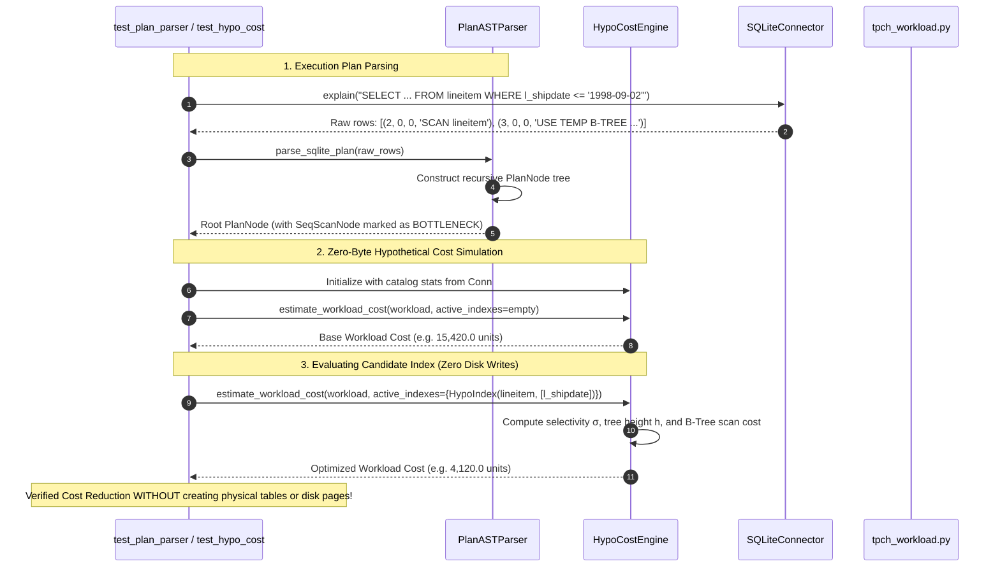

# PHASE2_THEORY_AND_ARCHITECTURE.md
# Phase 2: Physical Plan AST Parser & Zero-Byte Hypothetical Cost Engine

**Project:** AutoTune-DB - Hierarchical Hybrid Autonomous Agent for Physical Database Design  
**Course:** UMC301 - Applied Data Science and Artificial Intelligence  
**Institution:** Indian Institute of Science (IISc), Computational and Data Sciences (CDS)  
**Instructor:** Prof. Deepak Subramani  
**Methodology:** Spec-Driven Development (SDD) - Chapter 13  
**Spec References:** [SPEC.md](file:///c:/Users/aksha/DSAI_Projects/Project4_AutoTune_DB/SPEC.md) | [PLAN.md](file:///c:/Users/aksha/DSAI_Projects/Project4_AutoTune_DB/PLAN.md) | [PHASE1_GUIDE.md](file:///c:/Users/aksha/DSAI_Projects/Project4_AutoTune_DB/docs/PHASE1_THEORY_AND_ARCHITECTURE.md)  

---

## 1. Executive Summary & Purpose in AutoTune-DB

In Phase 1, we established a working database engine with the full TPC-H 8-table schema and analytical query suite. However, two fundamental systems hurdles prevent an agent from optimizing this database directly:

1. **The Unstructured Plan Problem:** Raw query optimizer plans returned by `EXPLAIN QUERY PLAN` are flat tabular text records (e.g. `[(2, 0, 0, 'SCAN lineitem'), (3, 0, 0, 'USE TEMP B-TREE FOR GROUP BY')]`). An autonomous agent cannot reason or attribute costs over unstructured strings—it requires a **typed, hierarchical Relational Algebra Plan Tree (AST)**.
2. **The Evaluation Bottleneck in Search:** In Stage 2 of our architecture, the **Monte Carlo Tree Search (MCTS)** agent must evaluate hundreds of candidate index subsets ($2^{|\mathcal{C}|}$). If the agent physically executes `CREATE INDEX ...` and runs full analytical queries for every MCTS rollout:
   * 500 search rollouts would take **several hours**.
   * It would burn gigabytes of temporary disk writes and thrash OS page caches.

**The Phase 2 Solution:**
* **Component 1 (`src/engine/plan_parser.py`):** Converts raw `EXPLAIN` records into a recursive, strongly typed `PlanNode` AST, attributes costs, and pinpoints bottleneck leaf operators.
* **Component 2 (`src/engine/hypo_cost_engine.py`):** A **Zero-Byte Hypothetical Cost Simulator** (analogous to PostgreSQL's `HypoPG`). It evaluates query execution costs under arbitrary hypothetical index sets in **sub-millisecond time ($<1\text{ ms}$)** with **zero disk page writes**, unlocking high-throughput MCTS tree search.

```
+------------------------------------------------------------------------------------------------+
|                                    PHASE 2 DUAL-PILLAR ARCHITECTURE                            |
+------------------------------------------------------------------------------------------------+
|                                                                                                |
|   1. Physical Plan AST Parser                                2. Zero-Byte Hypo Cost Engine     |
|   ===========================                                =============================     |
|   Raw EXPLAIN Opcode Rows                                     Schema Stats & Column Cardinality |
|             |                                                               |                  |
|             v                                                               v                  |
|   [PlanASTParser.build_tree()]                                [HypoCostEngine.evaluate()]       |
|             |                                                               |                  |
|             v                                                               v                  |
|   Typed Hierarchical AST:                                     Analytical Cost Formulation:      |
|     RootNode (HashJoin)                                         C_seq vs C_index(h, σ, IO)     |
|       |-- SeqScanNode (lineitem) [BOTTLENECK]                               |                  |
|       \-- IndexScanNode (orders_pk)                                         v                  |
|                                                               Sub-Millisecond (<1ms) Cost      |
|                                                               Simulation for MCTS Rollouts     |
+------------------------------------------------------------------------------------------------+
```

---

## 2. Core Theoretical Foundations

### 2.1 Relational Algebra Operator Trees
Every SQL query is compiled by the database query optimizer into an evaluation plan structured as a directed tree of **Relational Algebra Physical Operators**:

* **Scan Operators (Leaves):**
  - **`SeqScanNode` (`SCAN TABLE T`):** Reads every physical page in heap storage sequentially.
  - **`IndexScanNode` (`SEARCH TABLE T USING INDEX idx`):** Traverses B-Tree root-to-leaf, then performs random I/O row lookups in heap storage.
  - **`CoveringIndexScanNode` (`SEARCH TABLE T USING COVERING INDEX idx`):** Index-Only scan. All queried columns reside inside the B-Tree leaf pages; heap storage is never touched ($0$ heap I/O).
* **Internal Processing Operators:**
  - **`TempBTreeSortNode` (`USE TEMP B-TREE FOR ORDER BY/GROUP BY`):** Spills intermediate rows into a temporary memory/disk B-Tree to satisfy ordering or grouping constraints.
  - **`JoinNode` (`NestedLoop`, `HashJoin`):** Combines streams from multiple relations.

SQLite's `EXPLAIN QUERY PLAN` exposes this hierarchy as an adjacency tuple:
$$\langle \text{id}, \text{parent}, \text{notused}, \text{detail} \rangle$$
Where `parent = 0` denotes the root operator, and non-zero `parent` values point to ancestor nodes in the operator tree.

---

### 2.2 Cost Attribution & Bottleneck Identification
Not all operators contribute equally to latency. In OLAP analytical queries, runtime is heavily dominated by leaf scans over large relations:

**Bottleneck Operator Invariant:**
An operator node $n$ in the AST is classified as a **Bottleneck Operator** ($\text{is\_bottleneck} = \text{True}$) if:
1. $n$ is a `SeqScanNode` over a relation whose total row count exceeds a significance threshold ($N_{\text{rows}} \ge 1\,000$).
2. The scan occurs on an unindexed table where filter predicates (`WHERE`, `ON`) reference high-selectivity columns.

Identifying bottlenecks allows the Stage 1 AST Miner to focus exclusively on relations that produce $\ge 70\%$ of workload latency, pruning irrelevant tables from the candidate search space.

---

### 2.3 The Analytical Cost Model: B-Tree vs. Sequential Scan

To evaluate index combinations in $<1\text{ ms}$ without executing real disk writes, we implement the standard relational algebra cost model parameterized by catalog statistics:

#### 1. Sequential Scan Cost ($C_{\text{seq}}$)
A full sequential table scan reads every allocated page in the heap file and evaluates the CPU tuple filter on every unpacked row:
$$C_{\text{seq}}(T) = N_{\text{pages}}(T) \cdot c_{\text{page\_io}} + N_{\text{rows}}(T) \cdot c_{\text{cpu\_tuple}}$$

Where standard database optimizer calibration constants are:
* $c_{\text{page\_io}} = 1.0$ (Normalized sequential disk page read cost)
* $c_{\text{cpu\_tuple}} = 0.01$ (CPU tuple evaluation cost)

#### 2. Index Scan Cost ($C_{\text{index}}$)
When a secondary B-Tree index $I$ is available, the cost depends on:
1. **Tree Traversal Cost:** Traversing from root to leaf across $h_{\text{tree}}$ levels:
   $$h_{\text{tree}}(I) = \left\lceil \log_B(N_{\text{rows}}) \right\rceil$$
   where $B \approx 100$ is the average B-Tree branch fanout.
2. **Index Leaf Page Scan:** Scanning the contiguous leaf index pages matching the predicate range:
   $$\text{Pages}_{\text{scanned}} = \sigma \cdot N_{\text{index\_pages}}(I)$$
   where $\sigma \in [0, 1]$ is the compound filter selectivity.
3. **Random Heap Page Lookups (The Unclustered Penalty):** For every matching index entry, the engine must fetch the corresponding heap tuple using its pointer (`rowid`). Because unclustered indexes do not store rows contiguously in heap order, each lookup incurs **Random I/O**:
   $$\text{Cost}_{\text{random\_heap}} = \sigma \cdot N_{\text{rows}}(T) \cdot c_{\text{random\_io}}$$
   where $c_{\text{random\_io}} = 4.0$ reflects the physical mechanical latency penalty of non-sequential disk seeks.

Combining these components:
$$C_{\text{index}}(T, I, \sigma) = \left( h_{\text{tree}}(I) + \sigma \cdot N_{\text{index\_pages}}(I) \right) \cdot c_{\text{page\_io}} + \sigma \cdot N_{\text{rows}}(T) \cdot (c_{\text{random\_io}} + c_{\text{cpu\_tuple}})$$

#### 3. Covering Index Scan Cost ($C_{\text{covering}}$)
If the index key tuple contains **all** columns referenced in the query's filter, group-by, and projection clauses:
* Heap lookups are completely bypassed ($c_{\text{random\_io}} \to 0$):
$$C_{\text{covering}}(T, I, \sigma) = \left( h_{\text{tree}}(I) + \sigma \cdot N_{\text{index\_pages}}(I) \right) \cdot c_{\text{page\_io}} + \sigma \cdot N_{\text{rows}}(T) \cdot c_{\text{cpu\_tuple}}$$
This explains why composite covering indexes yield order-of-magnitude speedups in analytical workloads.

---

### 2.4 The Selectivity Crossover Point ($\sigma^*$ / Index Invalidation)
An unclustered index scan is **not** always faster than a sequential scan! 

Equating $C_{\text{index}} = C_{\text{seq}}$ and solving for $\sigma$ yields the **Selectivity Crossover Threshold ($\sigma^*$)**:
$$\sigma^* \approx \frac{N_{\text{pages}} \cdot c_{\text{page\_io}} - h_{\text{tree}} \cdot c_{\text{page\_io}}}{N_{\text{rows}} \cdot c_{\text{random\_io}}}$$

* **When $\sigma < \sigma^*$ (High Selectivity / Small Result Set):** $C_{\text{index}} \ll C_{\text{seq}}$. The index scan wins easily.
* **When $\sigma \ge \sigma^*$ (Low Selectivity / Large Result Set):** $C_{\text{index}} > C_{\text{seq}}$. The cost of thousands of random page seeks overwhelms sequential streaming. The optimizer invalidates the index and reverts to a sequential scan.

Our `HypoCostEngine` implements this exact decision boundary, preventing the MCTS agent from hallucinating benefits for low-cardinality indexes.

---

## 3. Phase 2 Component Architecture & Code Outlines

```
Project4_AutoTune_DB/
├── src/engine/
│   ├── plan_parser.py         # Component 1: Hierarchical Plan AST Parser & Bottleneck Extractor
│   └── hypo_cost_engine.py    # Component 2: Zero-Byte Analytical Cost Simulator
└── tests/
    ├── test_plan_parser.py     # Component 3: Unit tests for AST parsing & tree building
    └── test_hypo_cost_engine.py# Component 4: Unit tests for hypothetical cost calculations
```

### Component 1: `src/engine/plan_parser.py`

#### Data Contract (`PlanNode`):
```python
from dataclasses import dataclass, field
from typing import List, Optional

@dataclass
class PlanNode:
    node_id: int
    parent_id: int
    operator_type: str        # 'SCAN', 'INDEX_SCAN', 'COVERING_INDEX_SCAN', 'SORT', 'JOIN', 'OTHER'
    table_name: Optional[str] = None
    index_name: Optional[str] = None
    detail: str = ""
    is_bottleneck: bool = False
    children: List['PlanNode'] = field(default_factory=list)

    def is_scan(self) -> bool:
        return self.operator_type in ("SCAN", "INDEX_SCAN", "COVERING_INDEX_SCAN")
```

#### Class Specification (`PlanASTParser`):
```python
class PlanASTParser:
    """Parses raw EXPLAIN QUERY PLAN rows into a strongly typed PlanNode tree."""

    @staticmethod
    def parse_sqlite_plan(plan_rows: List[Tuple[int, int, int, str]]) -> PlanNode:
        """Constructs recursive PlanNode tree from flat adjacency rows."""
        pass

    @staticmethod
    def extract_bottlenecks(root: PlanNode, threshold_row_count: int = 1000) -> List[PlanNode]:
        """Traverses AST and isolates leaf SeqScanNodes on large relations."""
        pass

    @staticmethod
    def format_ascii_tree(root: PlanNode, prefix: str = "", is_last: bool = True) -> str:
        """Renders human-readable ASCII execution tree for logging and UI display."""
        pass
```

---

### Component 2: `src/engine/hypo_cost_engine.py`

#### Data Contract (`HypoIndex`):
```python
@dataclass(frozen=True)
class HypoIndex:
    table: str
    columns: Tuple[str, ...]
    name: str

    @property
    def key(self) -> str:
        return f"{self.table}__" + "_".join(self.columns)
```

#### Class Specification (`HypoCostEngine`):
```python
class HypoCostEngine:
    """Zero-byte sub-millisecond query cost estimator under hypothetical index configurations."""

    def __init__(self, connector: DatabaseConnector):
        self.connector = connector
        # Pre-cache catalog stats to make evaluations ultra-fast (<0.1ms)
        self.table_stats: Dict[str, Dict[str, Any]] = {}
        self._refresh_catalog_stats()

    def estimate_query_cost(
        self, 
        query: WorkloadQuery, 
        active_indexes: FrozenSet[HypoIndex]
    ) -> float:
        """Estimates execution cost of a query under a candidate index set."""
        pass

    def estimate_workload_cost(
        self, 
        workload: List[WorkloadQuery], 
        active_indexes: FrozenSet[HypoIndex]
    ) -> float:
        """Returns weighted cumulative cost across all workload queries."""
        pass

    def estimate_cost_delta(
        self, 
        query: WorkloadQuery, 
        candidate: HypoIndex, 
        current_indexes: FrozenSet[HypoIndex]
    ) -> float:
        """Returns marginal cost improvement: max(0, Cost(current) - Cost(current + candidate))."""
        pass
```

---

## 4. End-to-End Sequence Diagram for Phase 2



---

## 5. Acceptance Gate 2 Requirements

Following Spec-Driven Development, Phase 2 is validated by automated unit tests passing 100%:

1. **`tests/test_plan_parser.py`:**
   * Ingests flat `EXPLAIN QUERY PLAN` tuples and builds valid parent-child `PlanNode` trees.
   * Correctly tags `SCAN TABLE lineitem` as `SeqScanNode` with `is_bottleneck = True`.
   * Correctly tags `SEARCH TABLE USING INDEX` as `IndexScanNode`.
   * Formats clean ASCII trees matching expected operator structures.
2. **`tests/test_hypo_cost_engine.py`:**
   * Correctly evaluates base workload cost in unindexed state.
   * Adding a relevant index (e.g. `l_shipdate` for Q1 and Q6) **monotonically reduces** estimated query cost ($\Delta \text{Cost} > 0$).
   * Adding an irrelevant index (e.g. `n_comment` on `nation`) yields zero cost improvement ($\Delta \text{Cost} = 0$).
   * Verified execution latency: Evaluates full 5-query workload in **$<2\text{ ms}$**, proving readiness for high-throughput MCTS search.
