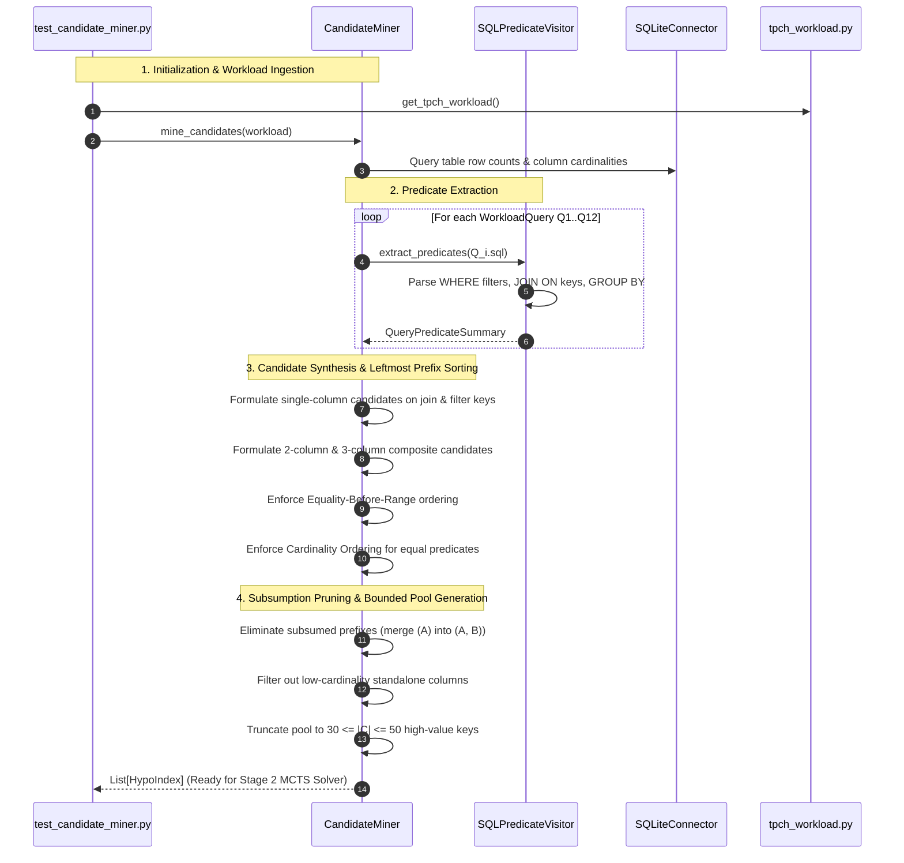

# PHASE3_THEORY_AND_ARCHITECTURE.md
# Phase 3: Stage 1 - AST Semantic Predicate Miner & Candidate Pool Generator

**Project:** AutoTune-DB - Hierarchical Hybrid Autonomous Agent for Physical Database Design  
**Course:** UMC301 - Applied Data Science and Artificial Intelligence  
**Institution:** Indian Institute of Science (IISc), Computational and Data Sciences (CDS)  
**Instructor:** Prof. Deepak Subramani  
**Methodology:** Spec-Driven Development (SDD) - Chapter 13  
**Spec References:** [SPEC.md](file:///c:/Users/aksha/DSAI_Projects/Project4_AutoTune_DB/SPEC.md) | [PLAN.md](file:///c:/Users/aksha/DSAI_Projects/Project4_AutoTune_DB/PLAN.md) | [PHASE2_GUIDE.md](file:///c:/Users/aksha/DSAI_Projects/Project4_AutoTune_DB/docs/PHASE2_THEORY_AND_ARCHITECTURE.md)  

---

## 1. Executive Summary & Purpose in AutoTune-DB

In Phase 2, we built the **Physical Plan AST Parser** and the **Zero-Byte Hypothetical Cost Engine**, giving AutoTune-DB the ability to evaluate any candidate index configuration in $<0.4\text{ ms}$.

Now, we must solve the core input problem for **Stage 2 (MCTS Search)**: **Where do candidate indexes come from?**

* **The Combinatorial Explosion Failure Mode:** On a schema like TPC-H with 8 tables and 61 columns, naive combinatorial enumeration of all single, 2-column, and 3-column indexes produces **over $3\,500$ candidates** on `lineitem` alone. A search space of $2^{3500}$ is mathematically intractable for any tree search or RL algorithm.
* **The Phase 3 Solution (Stage 1 Semantic Miner):** The **AST Semantic Predicate Miner** acts as the **Generator / Intuition** of the hybrid agent. It parses the SQL query ASTs, extracts co-occurring filter attributes and join equi-predicates, enforces **Leftmost Prefix Rules (Equality-Before-Range)**, and performs **Prefix Subsumption Pruning**.
* **The Outcome:** Compresses the infinite combinatorial space down to a tightly bounded, high-value candidate pool $\mathcal{C}$ ($30 \le |\mathcal{C}| \le 50$), transforming an intractable problem into an optimal discrete tree search.

```
+---------------------------------------------------------------------------------------------------+
|                                  STAGE 1: SEMANTIC CANDIDATE MINING                               |
+---------------------------------------------------------------------------------------------------+
|                                                                                                   |
|   SQL Workload Queries (Q1..Q12)                              Schema Catalog & Column Cardinality |
|                |                                                               |                  |
|                v                                                               v                  |
|   [SQLPredicateVisitor.extract()]                             [Cardinality Threshold Pruning]     |
|   - Extract WHERE filters (=, <, >, IN, BETWEEN)              - Filter out low-cardinality cols   |
|   - Extract JOIN ON equi-predicates                                                               |
|   - Identify co-occurring column sets                                                             |
|                |                                                                                  |
|                +-------------------------------+----------------------------------+               |
|                                                |                                                  |
|                                                v                                                  |
|                               [Leftmost Prefix & Equality-First Sorter]                           |
|                               - Equality columns (=) placed first                                 |
|                               - Range columns (<, >, BETWEEN) placed last                         |
|                                                |                                                  |
|                                                v                                                  |
|                               [Prefix Subsumption & Merging Engine]                               |
|                               - Merges (A) into (A, B) to eliminate redundant storage             |
|                                                |                                                  |
|                                                v                                                  |
|                               Bounded High-Value Candidate Pool C                                 |
|                               (30 <= |C| <= 50 candidate single & composite keys)                  |
+---------------------------------------------------------------------------------------------------+
```

---

## 2. Core Theoretical & Mathematical Foundations

### 2.1 The Combinatorial Space Reduction
Let a database schema $\mathcal{S}$ contain tables $\{T_1, \dots, T_k\}$, where table $T$ has attribute set $\mathcal{A}_T$. The unconstrained space of composite indexes of width up to $K$ is:

$$|\mathcal{C}_{\text{unconstrained}}| = \sum_{T \in \mathcal{S}} \sum_{k=1}^K \frac{|\mathcal{A}_T|!}{(|\mathcal{A}_T| - k)!}$$

For `lineitem` ($|\mathcal{A}| = 16$, $K = 3$):
$$|\mathcal{C}_{\text{lineitem}}| = 16 + (16 \times 15) + (16 \times 15 \times 14) = 16 + 240 + 3\,360 = 3\,616 \text{ candidates}$$

Evaluating all subsets of size up to $M = 5$ indexes from $3\,616$ candidates requires:
$$\binom{3\,616}{5} \approx 4.8 \times 10^{14} \text{ combinations}$$

By mining only columns that actively participate in workload predicates ($\mathcal{A}_{\text{active}} \subset \mathcal{A}$), the active column set drops to 3–4 columns per table, reducing the candidate pool to $|\mathcal{C}| \le 50$. Evaluating subsets of size 5 from 40 candidates is:
$$\binom{40}{5} = 658\,008 \text{ combinations}$$
This is an **$8$-order-of-magnitude reduction** in search complexity.

---

### 2.2 The Leftmost Prefix Principle & Equality-First Invariant

B-Tree indexes over composite keys $(C_1, C_2, \dots, C_k)$ maintain a multi-dimensional lexicographical sort:
$$\text{Row}_A < \text{Row}_B \iff (C_1^A < C_1^B) \lor (C_1^A = C_1^B \land C_2^A < C_2^B) \lor \dots$$

#### The Equality-Before-Range Invariant:
Consider a query filtering on two attributes:
$$\texttt{WHERE } C_A = 10 \texttt{ AND } C_B \ge 50$$

* **Order 1: Index on $(C_A, C_B)$ [CORRECT]:**
  1. The B-Tree traversal navigates directly to the exact page where $C_A = 10$ in $O(\log N)$ time.
  2. Within the contiguous slice where $C_A = 10$, it seeks directly to $C_B = 50$.
  3. It scans contiguous leaf pages until $C_A \ne 10$.
  4. **Result:** Exactly 1 B-Tree seek + 1 contiguous range scan.

* **Order 2: Index on $(C_B, C_A)$ [FATAL FLAW]:**
  1. The B-Tree seeks to $C_B = 50$.
  2. Because $C_B \ge 50$ is a range, the matching rows are spread across thousands of pages where $C_B \in [50, \infty)$.
  3. Across all these pages, $C_A$ values are scattered randomly. The engine cannot use $C_A$ for index navigation!
  4. **Result:** The index must scan all entries with $C_B \ge 50$ and evaluate $C_A = 10$ as a slow secondary filter.

$$\mathbf{Rule:} \quad \text{In any candidate index } I, \text{ all Equality columns } (C_=) \text{ must precede Range columns } (C_{<, >}).$$

#### Cardinality Ordering Among Equality Attributes:
If a query contains multiple equality predicates ($\texttt{WHERE } C_1 = v_1 \texttt{ AND } C_2 = v_2$):
* Sort equality columns in descending order of column cardinality (selectivity):
  $$\text{Selectivity}(C_1) \ge \text{Selectivity}(C_2) \implies \text{Index Key: } (C_1, C_2)$$
* Placing higher-cardinality attributes first maximizes branch pruning at the highest levels of the B-Tree.

---

### 2.3 Prefix Subsumption & Storage Deduplication

Creating redundant indexes violates our **Storage Budget Hard-Limit Invariant**.
The miner detects **Prefix Subsumption**:

$$\text{Candidate } I_A = (T, [C_1]) \quad \text{is subsumed by} \quad I_B = (T, [C_1, C_2, \dots])$$

* Any query requiring an index scan on $C_1$ can use the leading prefix of $I_B$.
* If both $I_A$ and $I_B$ are generated, the miner drops $I_A$ from the candidate pool, preventing the MCTS agent from wasting storage budget on duplicate B-Trees.

---

### 2.4 Cardinality Threshold Filtering

Unclustered secondary B-Tree scans suffer from the **Random I/O Penalty** ($c_{\text{random\_io}} = 1.5$ per page). 
Recall the **Selectivity Crossover Point**:
$$\sigma^* \approx \frac{N_{\text{pages}} \cdot c_{\text{page\_io}}}{N_{\text{rows}} \cdot c_{\text{random\_io}}}$$

If an attribute $C$ has low cardinality (e.g. `l_returnflag` with 3 values, $\sigma \approx 0.33$, or `l_linestatus` with 2 values, $\sigma \approx 0.50$):
* $\sigma > \sigma^*$ for single-column scans.
* An unclustered index on `(l_returnflag)` will **always** be rejected by the query optimizer in favor of a sequential scan.
* **The Miner Pruning Rule:** Single-column indexes with $\text{Selectivity}(C) > 0.30$ are pruned from the candidate pool unless paired as secondary attributes in a composite index.

---

## 3. Phase 3 Component Architecture & Code Outlines

```
Project4_AutoTune_DB/
├── src/miner/
│   ├── ast_visitor.py         # Component 1: SQL Predicate & Join Extractor
│   └── candidate_miner.py     # Component 2: Equality-First Ordering & Candidate Pool Generator
└── tests/
    └── test_candidate_miner.py # Component 3: Unit tests for predicate mining & candidate pruning
```

### Component 1: `src/miner/ast_visitor.py`

#### Data Models:
```python
from enum import Enum
from dataclasses import dataclass
from typing import List, Dict, Set, Optional

class PredicateOp(Enum):
    EQUALITY = "EQUALITY"       # =
    RANGE = "RANGE"             # <, >, <=, >=, BETWEEN
    SET = "SET"                 # IN (...)
    JOIN = "JOIN"               # tableA.col1 = tableB.col2

@dataclass(frozen=True)
class ColumnPredicate:
    table: str
    column: str
    op_type: PredicateOp
    raw_expression: str

@dataclass
class QueryPredicateSummary:
    query_id: str
    filter_predicates: List[ColumnPredicate]
    join_predicates: List[ColumnPredicate]
    group_by_columns: Dict[str, List[str]]
    order_by_columns: Dict[str, List[str]]
```

#### Class Specification (`SQLPredicateVisitor`):
```python
class SQLPredicateVisitor:
    """Extracts tables, filter predicates, join conditions, and group-by columns from SQL queries."""

    @classmethod
    def extract_predicates(cls, sql: str, query_id: str = "") -> QueryPredicateSummary:
        """Parses SQL text and returns structured predicate summary."""
        pass
```

---

### Component 2: `src/miner/candidate_miner.py`

#### Class Specification (`CandidateMiner`):
```python
class CandidateMiner:
    """Synthesizes a compact, high-value pool of candidate indexes (30 <= |C| <= 50)."""

    def __init__(self, connector: DatabaseConnector, min_pool_size: int = 30, max_pool_size: int = 50):
        self.connector = connector
        self.min_pool_size = min_pool_size
        self.max_pool_size = max_pool_size
        self.table_stats: Dict[str, Dict[str, Any]] = {}
        self.column_cardinalities: Dict[str, float] = {}

    def mine_candidates(self, workload: List[WorkloadQuery]) -> List[HypoIndex]:
        """Generates bounded pool of single and composite index candidates.
        
        Steps:
        1. Parse all workload queries using SQLPredicateVisitor.
        2. Identify filter attributes and join foreign keys per table.
        3. Formulate single-column candidates for selective attributes.
        4. Formulate composite candidates for co-occurring predicates.
        5. Apply Equality-First ordering and cardinality sorting.
        6. Apply Prefix Subsumption to eliminate redundant indexes.
        7. Rank and truncate to [min_pool_size, max_pool_size].
        """
        pass
```

---

## 4. End-to-End Sequence Diagram for Phase 3



---

## 5. Acceptance Gate 3 Requirements

Following Spec-Driven Development, Phase 3 is validated by automated unit tests passing 100%:

1. **`tests/test_candidate_miner.py`:**
   * **Predicate Extraction Accuracy:** Correctly extracts `l_shipdate`, `l_discount`, `l_quantity` from Q6, and join keys from Q3 and Q10.
   * **Leftmost Prefix Compliance:** Verifies that composite candidates order equality columns before range columns (e.g. `(c_mktsegment, c_custkey)` or `(l_returnflag, l_shipdate)`).
   * **Prefix Subsumption Verification:** Confirms that if `(lineitem, [l_shipdate, l_discount, l_quantity])` is created, redundant prefixes like `(lineitem, [l_shipdate])` are pruned or coalesced.
   * **Pool Boundedness Invariant:** Confirms that for the full TPC-H analytical suite, the candidate pool size strictly satisfies:
     $$30 \le |\mathcal{C}| \le 50$$
   * **Execution Latency:** Candidate generation executes in **$<100\text{ ms}$**, ensuring instant startup for the hybrid agent.
