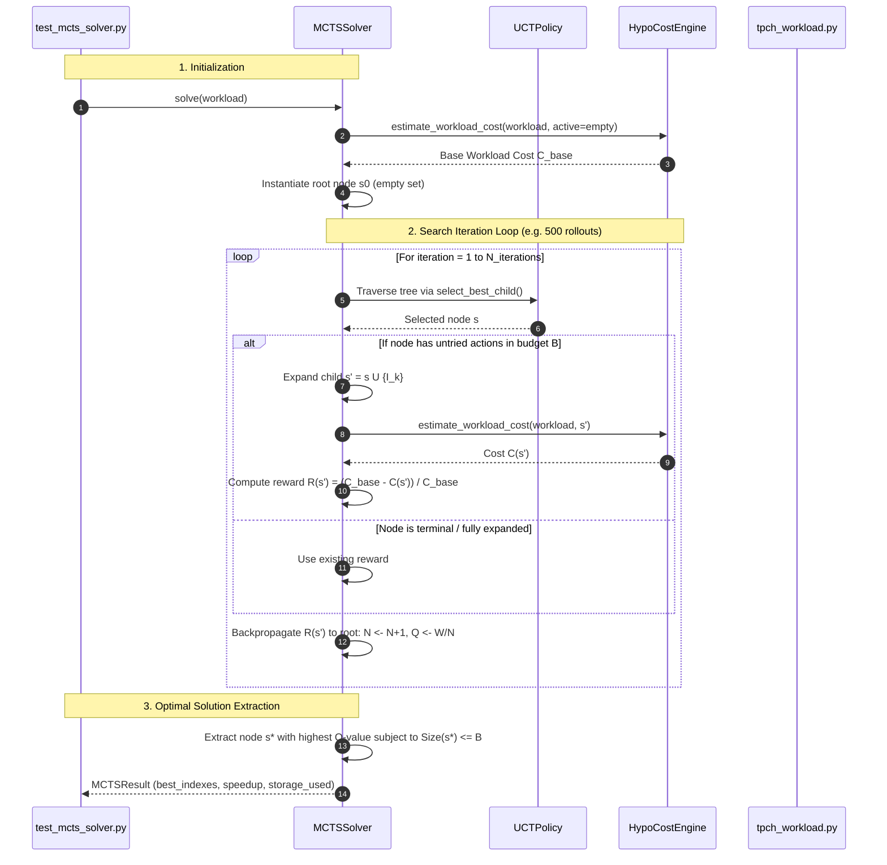

# PHASE4_THEORY_AND_ARCHITECTURE.md
# Phase 4: Stage 2 - MCTS Combinatorial Solver with UCT Policy

**Project:** AutoTune-DB - Hierarchical Hybrid Autonomous Agent for Physical Database Design  
**Course:** UMC301 - Applied Data Science and Artificial Intelligence  
**Institution:** Indian Institute of Science (IISc), Computational and Data Sciences (CDS)  
**Instructor:** Prof. Deepak Subramani  
**Methodology:** Spec-Driven Development (SDD) - Chapter 13  
**Spec References:** [SPEC.md](file:///c:/Users/aksha/DSAI_Projects/Project4_AutoTune_DB/SPEC.md) | [PLAN.md](file:///c:/Users/aksha/DSAI_Projects/Project4_AutoTune_DB/PLAN.md) | [PHASE3_GUIDE.md](file:///c:/Users/aksha/DSAI_Projects/Project4_AutoTune_DB/docs/PHASE3_THEORY_AND_ARCHITECTURE.md)  

---

## 1. Executive Summary & Purpose in AutoTune-DB

In Phase 3, the **AST Semantic Predicate Miner** compressed the unbounded combinatorial space into a high-value pool $\mathcal{C}$ of 30–50 candidate single and composite indexes.

Now, we build the computational core of AutoTune-DB: **Stage 2 (MCTS Combinatorial Solver)**.

* **The Problem:** We must select a subset of indexes $\mathcal{I}^* \subseteq \mathcal{C}$ that maximizes cumulative workload performance subject to a strict storage budget $B$:
  $$\max_{\mathcal{I} \subseteq \mathcal{C}} \frac{\text{Cost}_{\text{base}}(\mathcal{W}) - \text{Cost}(\mathcal{W}, \mathcal{I})}{\text{Cost}_{\text{base}}(\mathcal{W})} \quad \text{subject to} \quad \sum_{I \in \mathcal{I}} \text{SizeBytes}(I) \le B$$
* **Why Simple 0-1 Knapsack Fails:** In standard knapsack optimization, item values $v_i$ are independent. In database physical design, indexes exhibit **submodular, non-linear interactions**:
  - Adding index $I_A$ accelerates Query 1 and Query 6.
  - Adding composite index $I_B$ may partially or fully subsume $I_A$, making the marginal gain of having *both* strictly less than the sum of their individual gains.
* **The Phase 4 Solution:** **Monte Carlo Tree Search (MCTS)** guided by the **Upper Confidence Bound for Trees (UCT)**. MCTS treats index selection as a sequential Markov decision process, evaluating candidate combinations using our $<0.4\text{ ms}$ `HypoCostEngine` and strictly penalizing configurations that violate budget $B$.

```
+---------------------------------------------------------------------------------------------------+
|                                STAGE 2: MCTS COMBINATORIAL OPTIMIZATION                           |
+---------------------------------------------------------------------------------------------------+
|                                                                                                   |
|               Candidate Pool C (30-50 keys) + Storage Budget B (e.g. 25 MB)                       |
|                                             |                                                     |
|                                             v                                                     |
|                                  [Root Node s0 = empty set]                                       |
|                                             |                                                     |
|               +-----------------------------+-----------------------------+                       |
|               |                             |                             |                       |
|               v                             v                             v                       |
|         1. SELECTION                  2. EXPANSION                  3. SIMULATION                 |
|         ============                  ============                  =============                 |
|         Traverse tree using           Pick untried candidate        Evaluate hypothetical cost    |
|         UCT(s, a) = Q + c*sqrt(lnN/n) I_k that fits in B.           via HypoCostEngine (<0.4ms).  |
|         Balances exploitation         Instantiate child node.       Compute reward R(s).          |
|         and exploration.                                                                          |
|               |                             |                             |                       |
|               +-----------------------------+-----------------------------+                       |
|                                             |                                                     |
|                                             v                                                     |
|                                    4. BACKPROPAGATION                                             |
|                                    ==================                                             |
|                                    Propagate reward R(s) up path to root:                         |
|                                    N(s) <- N(s) + 1,  W(s) <- W(s) + R,  Q(s) <- W/N              |
|                                             |                                                     |
|                                             v                                                     |
|                          Optimal Configuration I* (Size <= B, Max Speedup)                        |
+---------------------------------------------------------------------------------------------------+
```

---

## 2. Core Theoretical & Mathematical Foundations

### 2.1 The Decision Process Formulation (MDP over Power Set $2^\mathcal{C}$)
We formulate the budget-constrained index selection problem as a discrete tree search:

* **State ($s \in \mathcal{S}_{\text{mcts}}$):** A set of active candidate indexes:
  $$s = \mathcal{I} \subseteq \mathcal{C}$$
  with cumulative physical storage footprint:
  $$\text{Size}(s) = \sum_{I \in \mathcal{I}} \text{SizeBytes}(I)$$
* **Root State ($s_0$):** $s_0 = \emptyset$ (unindexed database, $\text{Size}(s_0) = 0$).
* **Action Space ($\mathcal{A}(s)$):** Adding an unselected candidate index $I_k \in \mathcal{C} \setminus \mathcal{I}$ such that the budget constraint is preserved:
  $$\mathcal{A}_{\text{valid}}(s) = \{I_k \in \mathcal{C} \setminus \mathcal{I} \mid \text{Size}(\mathcal{I} \cup \{I_k\}) \le B\}$$
  A terminal action $\texttt{STOP}$ allows the search to terminate when no remaining candidate yields positive marginal utility.

---

### 2.2 The Upper Confidence Bound for Trees (UCT) Formula

At each selection step from node $s$, the agent selects the child action $a^*$ that maximizes the **UCT** value:

$$a^* = \arg\max_{a \in \mathcal{A}(s)} \left( Q(s, a) + c \cdot \sqrt{\frac{\ln N(s)}{N(s, a)}} \right)$$

Where:
* **$Q(s, a) = \frac{W(s, a)}{N(s, a)}$ (Exploitation Term):** The empirical mean reward of selecting index $a$ from state $s$.
* **$c \cdot \sqrt{\frac{\ln N(s)}{N(s, a)}}$ (Exploration Term):** The uncertainty bonus derived from **Hoeffding's Inequality** for multi-armed bandits (Auer, Cesa-Bianchi, Fischer, 2002).
  - $N(s)$ is the total visit count of node $s$.
  - $N(s, a)$ is the visit count of action $a$.
  - As $N(s)$ increases, unvisited actions gain a higher exploration bonus, preventing the agent from getting trapped in early suboptimal local minima.
* **Exploration Constant ($c$):** Set to the theoretical optimum $c = \sqrt{2} \approx 1.414$.

---

### 2.3 The Budget-Constrained Reward Function ($\mathcal{R}$)

The reward $\mathcal{R}(s)$ evaluates the holistic workload performance under the candidate index set $s = \mathcal{I}$:

$$\mathcal{R}(s) = \frac{\text{Cost}_{\text{base}}(\mathcal{W}) - \text{Cost}(s, \mathcal{W})}{\text{Cost}_{\text{base}}(\mathcal{W})} - \lambda \cdot \max(0, \text{Size}(s) - B)$$

Where:
* $\text{Cost}(s, \mathcal{W}) = \sum_{i=1}^m w_i \cdot \text{Cost}_{\text{hypo}}(Q_i \mid \mathcal{I})$ is computed via our zero-byte `HypoCostEngine` in $<0.4\text{ ms}$.
* $\text{Cost}_{\text{base}}(\mathcal{W})$ is the unindexed baseline cost.
* $\frac{\text{Cost}_{\text{base}} - \text{Cost}(s)}{\text{Cost}_{\text{base}}} \in [0.0, 1.0]$ represents the percentage workload improvement.
* **Penalty Multiplier ($\lambda = 100.0$):** If an action accidentally causes cumulative storage to exceed budget $B$, the heavy penalty drives the reward negative, ensuring the branch is pruned.

---

### 2.4 The 4-Step MCTS Search Algorithm

1. **Selection:**
   Starting at root $s_0$, recursively evaluate $\text{UCT}(s, a)$ to select children until reaching a leaf node or an unexpanded node.
2. **Expansion:**
   If the selected node $s$ has valid untried actions in $\mathcal{A}_{\text{valid}}(s)$, pop an untried action $I_k$, instantiate a new child node $s' = \mathcal{I} \cup \{I_k\}$, and add it to the tree.
3. **Simulation / Evaluation:**
   Compute the hypothetical cost of $s'$ across the full workload $\mathcal{W}$ using `HypoCostEngine`. Calculate reward $\mathcal{R}(s')$.
4. **Backpropagation:**
   Traverse the path from $s'$ back to the root $s_0$:
   $$N(s) \leftarrow N(s) + 1$$
   $$W(s) \leftarrow W(s) + \mathcal{R}(s')$$
   $$Q(s) \leftarrow \frac{W(s)}{N(s)}$$
   Update the node's `max_reward` tracker.

---

## 3. Phase 4 Component Architecture & Code Outlines

```
Project4_AutoTune_DB/
├── src/mcts/
│   ├── node.py                # Component 1: MCTS Tree Node Contract & State Representation
│   ├── uct_policy.py          # Component 2: Upper Confidence Bound for Trees (UCT) Selection
│   └── mcts_solver.py         # Component 3: Budget-Constrained Rollout Engine & Solution Extractor
└── tests/
    └── test_mcts_solver.py     # Component 4: Unit tests for MCTS convergence & budget enforcement
```

### Component 1: `src/mcts/node.py`

#### Data Model (`MCTSNode`):
```python
from dataclasses import dataclass, field
from typing import List, Dict, Set, Optional, FrozenSet
from src.engine.hypo_cost_engine import HypoIndex

@dataclass
class MCTSNode:
    """Represents a discrete index configuration state in the MCTS tree."""
    state_indexes: FrozenSet[HypoIndex]
    cumulative_size_bytes: int
    parent: Optional['MCTSNode'] = None
    action_from_parent: Optional[HypoIndex] = None
    children: Dict[HypoIndex, 'MCTSNode'] = field(default_factory=dict)
    untried_actions: List[HypoIndex] = field(default_factory=list)
    visits: int = 0
    total_reward: float = 0.0
    best_reward: float = 0.0

    @property
    def q_value(self) -> float:
        """Mean empirical reward Q(s) = W / N."""
        return self.total_reward / self.visits if self.visits > 0 else 0.0

    @property
    def is_fully_expanded(self) -> bool:
        return len(self.untried_actions) == 0

    @property
    def is_leaf(self) -> bool:
        return len(self.children) == 0
```

---

### Component 2: `src/mcts/uct_policy.py`

#### Class Specification (`UCTPolicy`):
```python
class UCTPolicy:
    """Implements Upper Confidence Bound for Trees selection policy."""

    @staticmethod
    def compute_uct(
        parent_visits: int,
        child_visits: int,
        child_q_value: float,
        c_param: float = 1.414
    ) -> float:
        """Computes UCT value: Q + c * sqrt(ln(N) / n)."""
        if child_visits == 0:
            return float('inf')  # Encourage unvisited exploration
        exploitation = child_q_value
        exploration = c_param * math.sqrt(math.log(parent_visits) / child_visits)
        return exploitation + exploration

    @classmethod
    def select_best_child(
        cls,
        node: MCTSNode,
        c_param: float = 1.414
    ) -> Tuple[HypoIndex, MCTSNode]:
        """Selects child node maximizing the UCT score."""
        pass
```

---

### Component 3: `src/mcts/mcts_solver.py`

#### Data Model (`MCTSResult`):
```python
@dataclass
class MCTSResult:
    best_indexes: List[HypoIndex]
    best_cost: float
    base_cost: float
    speedup_ratio: float
    storage_used_bytes: int
    storage_budget_bytes: int
    budget_utilized_percent: float
    iterations_completed: int
    search_time_ms: float
```

#### Class Specification (`MCTSSolver`):
```python
class MCTSSolver:
    """Budget-constrained MCTS combinatorial solver for the Index Selection Problem."""

    def __init__(
        self,
        cost_engine: HypoCostEngine,
        candidate_pool: List[HypoIndex],
        storage_budget_bytes: int,
        c_param: float = 1.414,
        iterations: int = 500,
        penalty_lambda: float = 100.0
    ):
        self.cost_engine = cost_engine
        self.candidate_pool = candidate_pool
        self.storage_budget_bytes = storage_budget_bytes
        self.c_param = c_param
        self.iterations = iterations
        self.penalty_lambda = penalty_lambda

    def solve(self, workload: List[WorkloadQuery]) -> MCTSResult:
        """Executes MCTS tree search and returns Pareto-optimal index configuration."""
        pass
```

---

## 4. End-to-End Sequence Diagram for Phase 4



---

## 5. Acceptance Gate 4 Requirements

Following Spec-Driven Development, Phase 4 is validated by automated unit tests passing 100%:

1. **`tests/test_mcts_solver.py`:**
   * **UCT Policy Formula:** Verifies correct calculation of exploitation and exploration terms. Unvisited children ($n=0$) must return $\infty$.
   * **Node Expansion & Hierarchy:** Verifies that child states strictly contain the parent state unioned with the selected index.
   * **Storage Budget Hard Invariant:** For varied budget limits (e.g. $B = 5\text{ MB}$, $B = 25\text{ MB}$), verifies that:
     $$\sum_{I \in \mathcal{I}^*} \text{SizeBytes}(I) \le B \quad (\text{100% compliance})$$
   * **Monotonic Improvement:** Confirms that the MCTS selected index configuration strictly improves performance over the unindexed baseline:
     $$\text{Speedup} = \frac{\text{Cost}_{\text{base}}}{\text{Cost}_{\text{opt}}} > 1.0$$
   * **Execution Latency:** 500 MCTS rollouts execute in **$<1.5\text{ seconds}$**, validating the sub-millisecond cost engine integration.
