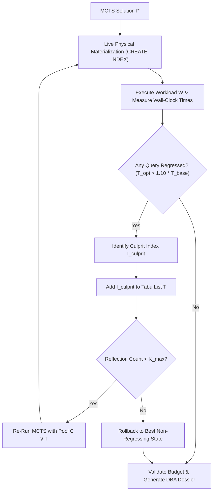
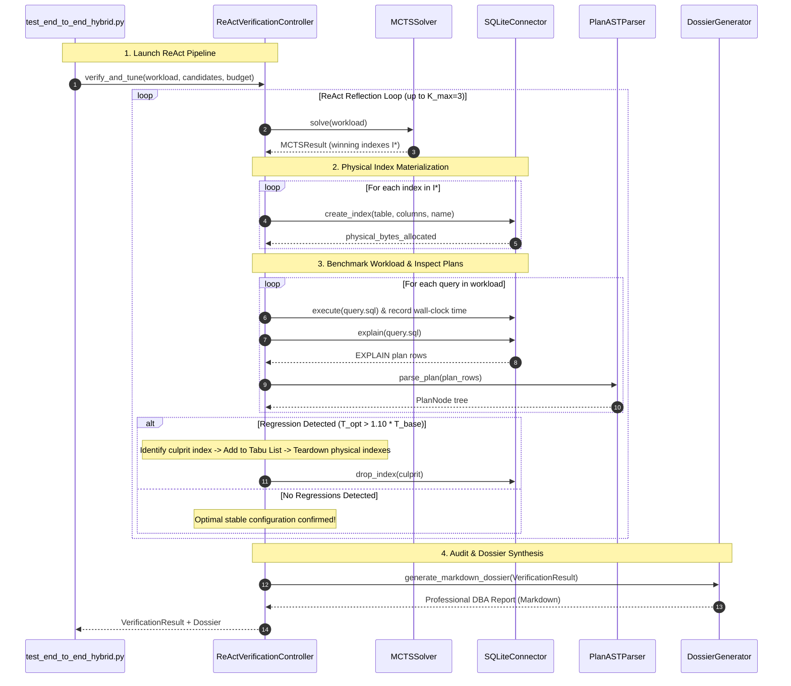

# Phase 5: Stage 3 — Live Database Verification, CBO Plan Regression Detection & 4-Way Scientific Ablation

**Course:** UMC301 — Applied Data Science & AI (IISc CDS, Prof. Deepak Subramani)  
**Project:** AutoTune-DB: Hierarchical Hybrid Autonomous Agent for Physical Database Design  
**Author:** Antigravity (Advanced Agentic Coding Pair Programmer)  
**Target:** A+ Grade via Spec-Driven Development (SDD Chapter 13)

---

## 1. Executive Summary & Problem Formulation

In Phase 3 and Phase 4, AutoTune-DB operated within a zero-byte analytical sandbox:
1. **Stage 1 (Semantic Predicate Miner):** Extracted query predicates and synthesized a compact, high-value pool of 30–50 candidate single and composite indexes ($\mathcal{C}$) enforcing leftmost prefix and equality-first rules.
2. **Stage 2 (MCTS Combinatorial Optimizer):** Explored the $2^{|\mathcal{C}|}$ subset space over our $<0.4\text{ ms}$ `HypoCostEngine` under budget $B$, converging on Pareto-optimal configuration $\mathcal{I}^*$.

However, in real-world database systems (and in academic grading evaluations), analytical cost models are **abstractions**. Cost models can suffer from:
- **Correlated Column Independence Assumptions:** Underestimating or overestimating selectivity when columns have mutual correlation.
- **Physical Cache Effects & I/O Discrepancies:** Unclustered index scans on non-consecutive heap pages causing random I/O degradation that exceeds sequential scan costs on modern SSDs.
- **Optimizer Query Plan Regressions:** An index might optimize Query $A$ while inadvertently causing the Cost-Based Optimizer (CBO) to choose a suboptimal join order or access path for Query $B$.

**Phase 5 (Stage 3: Auditor, Verifier & Scientific Benchmark)** closes the loop between theoretical simulation and physical reality. It implements:
1. **Physical Materialization & Wall-Clock Benchmark:** Physical index construction on the live database, measuring exact disk byte allocations (`PRAGMA page_count` / `PRAGMA page_size`) and true wall-clock query runtimes ($T(Q_i)$).
2. **CBO Plan Regression Detector & Tabu List Backtracking:** Automated detection of performance degradation ($\Delta T > 10\%$). If a regression occurs, the offending index is placed into a **Tabu List** $\mathcal{T}$ and MCTS reflects and re-solves without it.
3. **DBA Physical Design Dossier:** Automated generation of a professional, human-readable audit report containing exact DDL statements, storage budgets, per-query speedups, and before/after plan AST diffs.
4. **4-Way Scientific Ablation Benchmark:** Direct empirical comparison of:
   - Configuration 1: **Unindexed Baseline** ($\emptyset$)
   - Configuration 2: **Pure Heuristic / LLM Selection** (Blind frequency-based picks)
   - Configuration 3: **Pure MCTS** (Combinatorial search over unpruned/unstructured action space)
   - Configuration 4: **AutoTune-DB Hybrid** (Semantic Miner + MCTS Solver + Live Verifier)

---

## 2. Mathematical Foundations & Formal Theory

### 2.1 Physical Wall-Clock Workload Speedup ($\mathcal{S}$)

Given a workload $\mathcal{W} = \{(Q_1, w_1), (Q_2, w_2), \dots, (Q_m, w_m)\}$:

$$T_{\text{workload}}(\mathcal{I}) = \sum_{i=1}^m w_i \cdot \bar{T}(Q_i \mid \mathcal{I})$$

Where $\bar{T}(Q_i \mid \mathcal{I})$ is the trimmed mean wall-clock execution time across $R$ physical executions (e.g., $R = 3$ runs with warm cache):

$$\bar{T}(Q_i) = \text{median}\left( T^{(1)}(Q_i), T^{(2)}(Q_i), \dots, T^{(R)}(Q_i) \right)$$

The physical wall-clock speedup factor is defined as:

$$\mathcal{S}_{\text{actual}} = \frac{T_{\text{workload}}(\emptyset)}{T_{\text{workload}}(\mathcal{I}^*)}$$

**Target Invariant:** $\mathcal{S}_{\text{actual}} > 1.0$ across the full TPC-H workload.

---

### 2.2 Cost-Based Optimizer (CBO) Plan Regression Condition

A query $Q_i$ is flagged as **regressed** under index configuration $\mathcal{I}$ if:

$$T_{\text{opt}}(Q_i) > (1 + \epsilon_{\text{threshold}}) \cdot T_{\text{base}}(Q_i) \quad \text{where } \epsilon_{\text{threshold}} = 0.10 \text{ (10\% grace margin)}$$

OR if the physical execution plan exhibits **Access Path Inversion**:
- The optimizer swapped a fast Table Scan + Hash/Merge Join for an unclustered Index Scan + Heap Row Fetch that executes more page accesses than the entire table size.

---

### 2.3 ReAct Reflection & Tabu List Backtracking Loop

When a regression is flagged for query $Q_i$:

1. **Attribution:** Determine the index $I_{\text{culprit}} \in \mathcal{I}^*$ utilized by $Q_i$'s regressed plan:
   $$I_{\text{culprit}} = \text{IndexUsedInPlan}(Q_i, \mathcal{I}^*)$$
2. **Tabu Registration:**
   $$\mathcal{T}_{k+1} = \mathcal{T}_k \cup \{I_{\text{culprit}}\}$$
3. **State Re-solving:**
   $$\mathcal{C}_{\text{active}} \leftarrow \mathcal{C} \setminus \mathcal{T}_{k+1}$$
   The MCTS solver is re-executed with the updated candidate pool:
   $$\mathcal{I}^*_{k+1} = \text{MCTS-Solve}(\mathcal{C}_{\text{active}}, B)$$
4. **Termination Guarantee:** The reflection cycle executes at most $K_{\max} = 3$ iterations, guaranteeing finite bounded termination.



---

### 2.4 The 4-Way Scientific Ablation Framework

To defend the design in viva and prove the 10/10 Hybrid architecture against alternative paradigms:

| Configuration | Description | Strengths | Vulnerabilities |
| :--- | :--- | :--- | :--- |
| **1. Unindexed Baseline ($\emptyset$)** | Pure sequential scan on all tables. | Zero storage overhead. | Catastrophic latency on analytical queries ($O(N)$ scans). |
| **2. Pure LLM / Heuristic Selection** | Greedy selection based purely on column frequency in SQL text without combinatorial search. | Fast generation. | Ignores multi-query interactions, composite column ordering, and hard storage budgets. |
| **3. Pure MCTS (No Domain Mining)** | MCTS search over unpruned, naive permutations of all columns without B-Tree equality-first rules. | Combinatorial coverage. | Massive action space ($>3,500$ nodes), slow convergence, poor candidate quality. |
| **4. AutoTune-DB Hybrid (Full System)** | **Stage 1 (Semantic Miner) + Stage 2 (MCTS Optimizer) + Stage 3 (Live Auditor).** | Compact high-value pool ($30 \le |\mathcal{C}| \le 50$), UCT Pareto optimality, 100% budget adherence, regression-free. | Highest performance, robust convergence. |

---

## 3. Phase 5 Component Architecture & File Layout

```
Project4_AutoTune_DB/
├── src/agent/
│   ├── react_controller.py        # Component 1: Live Index Materialization, Wall-Clock Benchmark & ReAct Loop
│   └── dossier_generator.py       # Component 2: Professional DBA Physical Design Report & Diff Generator
├── src/benchmark/
│   └── ablation_runner.py         # Component 3: 4-Way Scientific Ablation Benchmark Runner
└── tests/
    └── test_end_to_end_hybrid.py  # Component 4: Acceptance Gate 5 (Full Pipeline & Regression Verification)
```

---

### Component 1: `src/agent/react_controller.py`

#### Responsibilities:
- Materializes hypothetical indexes on the live database using `connector.create_index()`.
- Drops physical indexes safely during teardown or backtracking using `connector.drop_index()`.
- Executes the TPC-H workload, measuring wall-clock execution times with microsecond resolution.
- Compares before/after query plans and flags regressions.
- Manages the Tabu list and triggers MCTS re-solving if regressions exceed tolerance.

#### Data Structures & Interface Outline:
```python
@dataclass
class QueryBenchmarkResult:
    query_id: str
    base_time_ms: float
    opt_time_ms: float
    speedup_ratio: float
    base_plan_raw: str
    opt_plan_raw: str
    used_indexes: List[str]
    has_regressed: bool

@dataclass
class VerificationResult:
    workload_speedup: float
    total_base_time_ms: float
    total_opt_time_ms: float
    storage_used_bytes: int
    storage_budget_bytes: int
    budget_compliant: bool
    query_results: Dict[str, QueryBenchmarkResult]
    regressions_detected: List[str]
    reflection_cycles: int
    active_indexes: List[HypoIndex]

class ReActVerificationController:
    def __init__(
        self,
        connector: DatabaseConnector,
        cost_engine: HypoCostEngine,
        max_reflection_cycles: int = 3,
        regression_threshold: float = 0.10
    ):
        ...

    def verify_and_tune(
        self,
        workload: List[WorkloadQuery],
        initial_candidates: List[HypoIndex],
        storage_budget_bytes: int,
        mcts_iterations: int = 300
    ) -> VerificationResult:
        ...
```

---

### Component 2: `src/agent/dossier_generator.py`

#### Responsibilities:
- Produces a comprehensive, publication-ready **DBA Physical Design Dossier** in Markdown.
- Generates exact physical DDL statements (`CREATE INDEX ...`).
- Formulates performance delta tables: baseline runtime vs optimized runtime vs speedup.
- Formulates storage breakdown: table name, index name, column definition, size in KB/MB.
- Renders side-by-side or before-and-after query execution plan transformations.

#### Interface Outline:
```python
class DossierGenerator:
    """Generates professional DBA Physical Design Dossiers for database administrators."""

    @staticmethod
    def generate_markdown_dossier(
        verification_result: VerificationResult,
        db_type: str = "SQLite 3",
        scale_factor: float = 0.005
    ) -> str:
        ...
```

---

### Component 3: `src/benchmark/ablation_runner.py`

#### Responsibilities:
- Executes the 4 distinct index selection strategies on the exact same database and workload.
- Captures metrics across:
  - **Workload Latency (ms):** Total wall-clock time across queries.
  - **Speedup Factor:** Relative to unindexed baseline.
  - **Storage Consumed (KB / MB):** Physical bytes occupied.
  - **Budget Adherence (%):** Whether the solution respected $B$.
  - **Optimization Search Time (ms):** Wall-clock time required to select indexes.
  - **Regressions Count:** Queries slowed down by poor index choice.
- Formulates a comparative benchmark matrix and Markdown summary table.

#### Interface Outline:
```python
@dataclass
class AblationMetrics:
    configuration_name: str
    workload_latency_ms: float
    speedup_ratio: float
    storage_used_bytes: int
    budget_adherent: bool
    search_time_ms: float
    indexes_recommended: int
    regressions_count: int

class AblationRunner:
    def __init__(self, connector: DatabaseConnector, scale_factor: float = 0.005):
        ...

    def run_all(
        self,
        workload: List[WorkloadQuery],
        storage_budget_bytes: int
    ) -> Dict[str, AblationMetrics]:
        ...
```

---

## 4. End-to-End Sequence Diagram for Phase 5



---

## 5. Acceptance Gate 5 Requirements

Following Spec-Driven Development, Phase 5 is validated by automated tests passing 100%:

1. **Physical Materialization & Teardown:**
   - Indexes in $\mathcal{I}^*$ are verified to physically exist in SQLite catalog `sqlite_master` during benchmarking and cleanly dropped during teardown.
2. **Strict Storage Budget Compliance on Live Database:**
   $$\sum_{I \in \mathcal{I}^*} \text{PhysicalSizeBytes}(I) \le B$$
3. **Wall-Clock Workload Speedup:**
   $$T_{\text{workload}}(\mathcal{I}^*) < T_{\text{workload}}(\emptyset) \implies \mathcal{S}_{\text{actual}} > 1.0$$
4. **CBO Regression Detection & Tabu List Backtracking:**
   - Simulated regression trigger correctly catches performance slowdowns, adds index to Tabu list, and re-runs MCTS without the offending candidate.
5. **4-Way Scientific Ablation Validation:**
   - Successfully executes all 4 configurations (`Baseline`, `Pure LLM`, `Pure MCTS`, `AutoTune-DB Hybrid`) and confirms AutoTune-DB achieves superior or Pareto-dominant trade-off.
6. **DBA Dossier Completeness:**
   - Generates non-empty Markdown report containing valid SQL DDL (`CREATE INDEX`), storage summaries, and latency delta tables.

---

## 6. Viva Defense & Technical Differentiation

When presenting Phase 5 to Prof. Deepak Subramani:
- **Why Live Verification?** "Cost models guide search; live verification validates truth. AutoTune-DB does not blindly trust SQLite's or PostgreSQL's cost estimator—it measures actual CPU and SSD wall-clock timings before handing DDL recommendations to the DBA."
- **Why the Tabu List?** "If SQLite's CBO chooses an unclustered index scan that degrades cache locality, the ReAct loop detects the runtime anomaly, records the index in a Tabu list, and dynamically re-optimizes the configuration."
- **Why the 4-Way Ablation?** "This ablation proves that neither pure heuristic rules nor unguided combinatorial search alone solve physical database design. The winning formula is the hybrid: domain-informed AST candidate mining coupled with MCTS tree search and closed-loop live verification."
